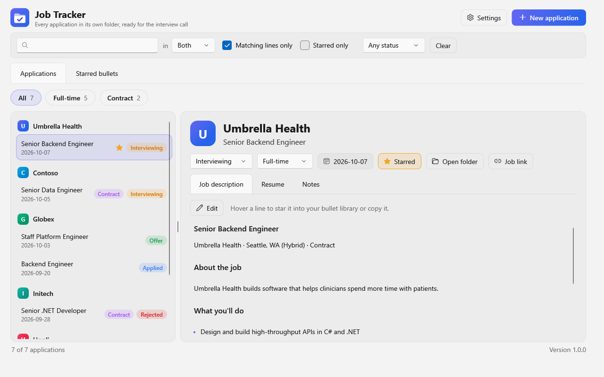
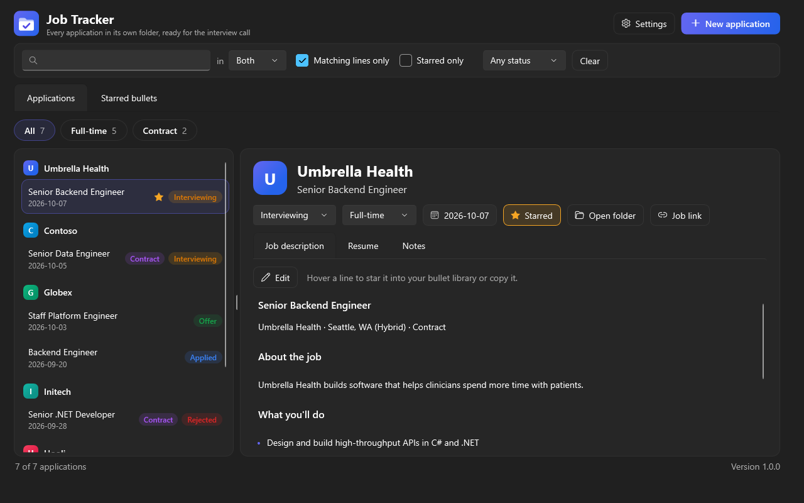
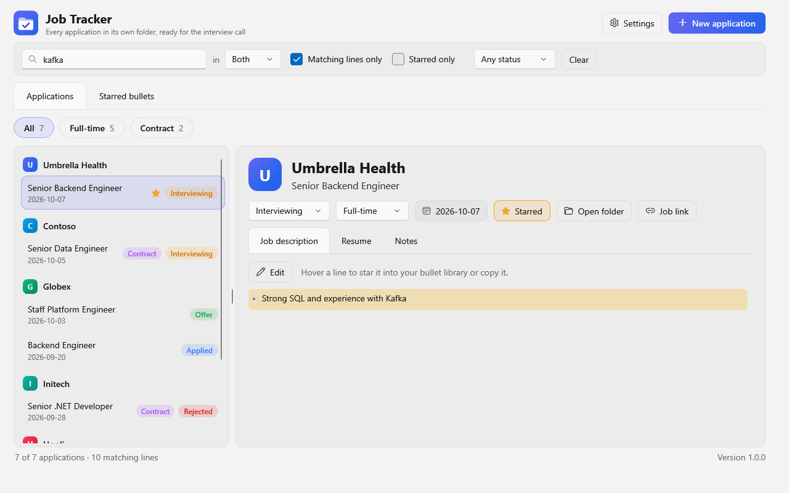
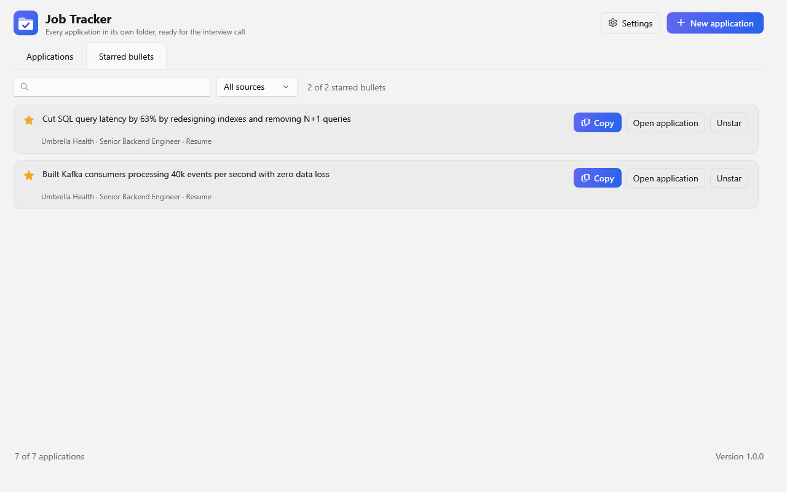
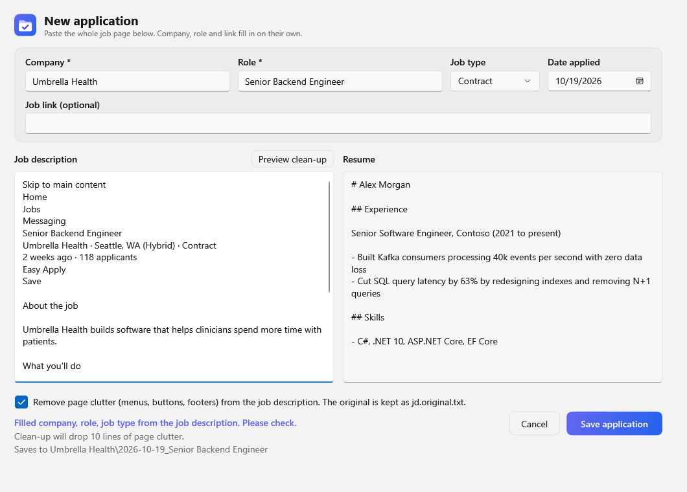

<p align="center">
  
</p>

<h1 align="center">Job Tracker</h1>

<p align="center">
  A Windows desktop app that keeps every job application in its own folder.<br>
  Paste the job page and your tailored resume: it saves both under the company and date, so you can find exactly what you sent when an interview is scheduled.
</p>

<p align="center">
  <a href="https://github.com/srinadhmanchikalapudi/job-tracker/releases/latest"><b>Download for Windows</b></a> &nbsp;·&nbsp;
  <a href="#install-in-3-steps">Install in 3 steps</a> &nbsp;·&nbsp;
  <a href="#using-the-app">Using the app</a> &nbsp;·&nbsp;
  <a href="#screenshots">Screenshots</a>
</p>

<p align="center">
  
  
  
  
  
  <a href="https://github.com/srinadhmanchikalapudi/job-tracker/releases/latest"></a>
  <a href="https://github.com/srinadhmanchikalapudi/job-tracker/actions/workflows/ci.yml"></a>
</p>

---

## Install in 3 steps

No technical knowledge needed. You need a Windows 10 or 11 PC.

1. **Download.** Open the [latest release](https://github.com/srinadhmanchikalapudi/job-tracker/releases/latest), scroll to **Assets** and click **`JobTracker-Setup-<version>.exe`**. It is about 57 MB.
2. **Run it.** Open the file from your Downloads folder.
   - If Windows shows a blue **"Windows protected your PC"** screen, that is expected (the app is not code-signed yet). Click **More info**, then **Run anyway**.
   - Click **Next** through the installer, then **Finish**. It installs just for you and asks for no administrator password.
   - One page asks **where your applications should be saved**. The default is a `JobApplications` folder on your Desktop; type or browse to another folder if you prefer. You can change it later in Settings.
3. **Open Job Tracker** from the Start menu and click **New application**.

It updates itself later: a bar appears at the top when a new version is out, and one click installs it. Your applications are never touched by an update or an uninstall.

---

## What it does

Applying to jobs means tailoring a resume for each posting. A week later, when a recruiter calls, you need that exact posting and that exact resume. Job Tracker keeps them together.

- **Paste, don't type.** Copy the whole job page (Ctrl+A, Ctrl+C) and paste it in. Company, role and link fill in on their own.
- **Remove an application you added by mistake.** The **Remove** button in the application's header asks first, then moves its whole folder (job description, resume, notes, saved versions and any files you added) to the Windows Recycle Bin, so you can restore it from there. It refuses to touch anything that is not an application folder directly under a company folder of your data folder. Bullets you starred from it stay in Starred bullets. Nothing is removed permanently by the app.
- **A warning when you paste the same job twice.** A company can have many roles, so a new job at the same company saves normally. But if the job description you are saving is 70% or more the same as one already saved for that company (a re-posting, or the same role listed twice), you are asked first. A window shows both descriptions side by side with the lines that are only in one of them highlighted, and the percentage, counted from the words in order (capitalisation and punctuation are ignored). Choose **Go back** (everything you typed is kept), **Save anyway** if it is a different role, or **Open the saved one**. Nothing is ever replaced or deleted.
- **Attach your resume as a file.** In New application, attach a PDF, a Word document (.docx), or a Markdown or text file, with the **Attach file** button or by dropping it on the resume box. Its text is read into the box so you can check it (one bullet per line, wrapped lines joined, two columns read in order), and the original file is kept with the application as `resume.original.pdf` or `.docx`. A PDF that is only a picture of text is reported, not guessed at: there is no OCR.
- **Tailor your resume to a job.** Each application has a **Match** tab. It lists the skills the job description asks for (required, part of the work, or nice to have) and which of them your resume already says, with a percentage counted from the two texts, not guessed. For a skill you have really used but never wrote down, click **I've used it** and describe it in a sentence. **Improve bullets…** has three tabs, with your bullets listed under the job they belong to: **add new bullets** to a job (the first tab), reword **one bullet**, or reword **a whole job** (every bullet of one job together, each ticked change optional). New bullets are written from what you type about your work. You can also type just a skill (like Kubernetes), or tick one of the **Not in your resume** keywords from the job description, and the bullet ties it to work that job already describes, adding nothing else; the window says it cannot know that is how you used it, so you read it and add it only if it is true. To get a bullet for every ticked skill even where your resume shows no related work, turn on **Write a bullet for each skill I tick**: each bullet then describes the kind of work the job involves (taken from its other bullets and the job description), with no numbers or results added, and the window lists any skill that still got no bullet and why. If you leave everything blank they can only restate what the job's bullets already say in a different way, and the window tells you so. While the AI is working, a bar at the bottom of the window shows how many seconds it has been and has a **Stop** button, so a slow answer is never mistaken for a frozen window. Each rewrite shows a word-by-word before and after. Anything that adds a number, a tool, a role or a name that is not in your resume or your own notes is thrown out before you see it, with the reason. The bullet list can be narrowed with the **Show** drop-down (all bullets, one job, or bullets under no job). **Preview Word document** (in that window, and **Word document** on the Match tab) makes a Word file of the result and shows the whole page on screen. The upload-ready file is made by itself, as soon as an application is saved and every time you choose a resume (**Use as my resume**) or edit it. It is saved in the application's folder named like `Priya_Raman_Resume.docx` (first and last name from the top of your resume, then Resume, joined with underscores: no spaces, accents or company name, which is what job sites and mail programs handle best), so you can select it in the folder and press Ctrl+C, or click **Copy file**. When you choose a different resume, the old file is deleted and a new one is made from the one you chose, so the file in the folder always matches your resume in use (only a file Job Tracker made is ever replaced). Previewing a version that is not your resume yet puts its Word file in a `Word versions` folder instead, with a **Use as my resume** button in the preview, so it never replaces your upload-ready file. The window has **Open file location**, **Open in Word** and **Download…**. If you attached a Word resume, the file is a copy of it with only your changes made in it, so your fonts and layout stay; otherwise (a PDF or pasted resume, or a layout that cannot be edited safely) it is a clean one-column document with real headings and bullets. Either way the finished file is read back and checked against your text. Accepted changes are saved as a new version (`resume.v2.md`; its Word file is made when you preview it); your resume file changes only if you choose **Use as my resume**, and the old text is kept as another version first. Rewording needs an AI key of your own (OpenRouter or Anthropic) in **Settings**, where the **Model** box is a drop-down of the models the service offers (read from the service itself, Claude models first, with a short built-in list if it cannot be reached); the Match tab works without one.
- **Build a resume from scratch.** **My resume** (top right) walks you through contact details, a summary, your jobs, education and skills, and saves as you type, in your data folder so OneDrive backs it up. Each job's bullets can be typed, put together from parts ("I… built … using … result …"), or written by the AI helper from your own answers: the helper may use only what you typed, and anything that adds a number, tool or result you did not write is thrown out. Fixed-rule tips sit beside weak bullets ("Responsible for…", too long, no number), and a Review tab lists what is still missing. **Preview Word document** shows the whole page and offers Open file location and Download…. In **New application**, **Use my resume** fills the resume box with it, so tailoring works on it like any other resume.
- **Pay, picked up from the posting.** The pay a job description states (a salary range, "$60 - $70 an hour", a day or monthly rate, "up to" or "from" amounts) is shown next to the date on every application, full-time or contract, in short form in the list ("$60–$70/hr", "$140k–$170k/yr"), and in the New application window as you paste. The list reads the descriptions in the background and remembers the answer in `.jobtracker\pay-cache.json` (only a shortcut; safe to delete), so it does not open every file each time the app starts. Hover it for the line it came from and, for an hourly rate, what that comes to in a year. If the posting states none (just "competitive"), it says **Not available**. Company revenue, funding, bonuses, stipends and benefits are never mistaken for pay.
- **Clean job descriptions.** Menus, buttons, "Similar jobs" lists and cookie banners are removed. Headings, bullets and blank lines stay exactly as pasted. A preview shows the result first, and the original is kept as `jd.original.txt`.
- **Full-time and contract, kept apart.** Tabs above the applications (All, Full-time, Contract, each with a count) separate the two kinds. Choose the type when you add an application: it is filled in for you when the posting says "Contract", and it starts as the tab you are on. You can change it later, and the application moves to the other tab.
- **Backed up by OneDrive.** Settings tells you whether your applications are in OneDrive, and moves them there in one click if they are not. With Documents synced to OneDrive, a new install saves there by default, so a damaged profile or a Windows reset does not take your applications with it.
- **See what changed, inside the app.** **What's new** is on the update bar and in Settings, and it opens by itself once after each update. No need to visit GitHub.
- **One folder per application**, easy to find in Explorer: `JobApplications\<Company>\<date>_<Role>\`.
- **Search by keyword** inside job descriptions, resumes, or both. Every word must appear, and matching lines are highlighted.
- **Star the lines you want to reuse.** Hover any line to star it into your bullet library, or copy it (the leading dash is dropped). The **Starred bullets** tab is a searchable library of your best resume lines.
- **Track where each one stands:** Applied, Interviewing, Offer, Rejected or Withdrawn, with a notes tab for interview details.
- **Light and dark** to match Windows. Free, open source, and nothing leaves your computer except an optional once-a-day check for a new version, and, only if you add an AI key and click **Suggest rewrites**, the bullet you picked, the job description and your notes, sent to the service you chose (you are asked first). Opening Settings with AI set up also asks that service for the list of model names (OpenRouter's list is public, so no key is sent to it; Anthropic's list is requested with your key).

## Screenshots

| | |
|---|---|
|  |  |
|  |  |



(The screenshots use invented sample data.)

## Using the app

| To do this | Do this |
|---|---|
| Add an application | **New application** (Ctrl+N). Paste the job page into the job description box, paste your resume, check the filled-in company and role, and click **Save application**. |
| See the cleaned description before saving | **Preview clean-up** above the job description box. Untick the clean-up checkbox to keep the paste exactly as it is. |
| Keep contract and full-time roles apart | Use the **All / Full-time / Contract** tabs above the list. **Job type** in the New application window decides the tab (it is picked for you when the posting says contract, and starts as the tab you are on). To change it later, use the job type box on the application. |
| Find an application | **Search** (Ctrl+F). Choose **JD**, **Resume** or **Both**, tick **Matching lines only** to hide everything else, and filter by status or starred. |
| Keep a resume line for later | Hover the line and click the star. It appears under **Starred bullets** with its company and role. |
| Copy a line into a new resume | Click the copy icon on the line, or **Copy** in Starred bullets. |
| Open the folder in Explorer | **Open folder** on the application. |
| Change where applications are saved | **Settings**, **Change…** (default: `Desktop\JobApplications`). Works any time, even with many applications saved: see [Changing the folder](#changing-the-folder). |

## Where your files go

```
JobApplications\
  Acme Corp\
    2026-10-07_Senior Backend Engineer\
      jd.md  resume.md  notes.md  meta.json     # meta.json holds the status and whether it is full-time or contract
      jd.original.txt                  # the JD exactly as pasted, only when clean-up changed it
      resume.original.pdf              # the resume file you attached (or .docx, .md, .txt), kept untouched
  .jobtracker\bullets.json             # your starred bullets
```

These are plain text files. You can open and edit them in any editor, and the app picks the changes up. The folder is yours: uninstalling Job Tracker never deletes it. The app's own small settings file is in `%APPDATA%\JobTracker\settings.json`.

## Changing the folder

Where applications are saved is your choice, at three points:

- **When installing:** the setup program has a page for it. The suggestion is a `JobApplications` folder that already exists, otherwise **Documents when OneDrive syncs it** (so your applications are backed up), otherwise your Desktop. It is skipped when you update or re-install, because you chose already.
- **Any time later:** **Settings**, **Change…**. If you pick a folder that already holds other files (for example Documents), Job Tracker offers to create a `JobApplications` folder inside it so your applications stay together.
- **With applications already saved:** Job Tracker asks whether to **move them** to the new folder or just **use the new folder** and leave the old ones where they are.
  - Moving copies every application (job description, resume, notes, any extra files you added, and your starred bullets), checks that the copy matches, switches to the new folder, and only then removes the old files. If anything goes wrong before that, the copy is undone and nothing changes.
  - If the new folder already holds an application with the same name, nothing is overwritten: the moved one is added next to it as `... (2)`.
  - Switching back to a folder you used before brings its applications straight back.

### Backup with OneDrive

Job Tracker does not copy files anywhere itself: it keeps your applications in one folder, and **a folder inside OneDrive is backed up by OneDrive**. **Settings** shows which case you are in:

- **Backed up by OneDrive** (green): your applications are inside a OneDrive folder. If your profile is damaged or Windows is reset, sign in to OneDrive again and they come back. After a reinstall, Job Tracker looks in `Documents\JobApplications` and `Desktop\JobApplications` for existing applications before it picks a default, so it finds them again by itself. (A folder you chose elsewhere needs choosing again in Settings.)
- **In OneDrive, but OneDrive is not running**: start OneDrive so your changes are uploaded.
- **Only on this PC**: if you have OneDrive, **Move to OneDrive** moves your applications into `Documents\JobApplications` (or the OneDrive folder, if Documents is not synced). It uses the same safe move as above.

### Installing for other people

A silent install can choose the folder up front, which is handy for sharing the app:

```
JobTracker-Setup-1.1.0.exe /VERYSILENT /DATAROOT="D:\Jobs"
```

`/DATAROOT` is a starting point for anyone who has no settings yet; people can still change it in Settings. A path may use environment variables, such as `%USERPROFILE%\Documents\Jobs`. If it is left out, each person gets `JobApplications` on their own Desktop.

## What's new

Open **What's new** from the update bar (it shows the waiting version's notes before you install), or from **Settings** (every version, newest first, even offline: the notes of the installed versions are part of the app). After an update, it opens by itself once. The notes live in `src/JobTracker.Core/WhatsNew.md`, written for the people who use the app.

## Updates and privacy

- The app does not collect or send anything. The only network request is the optional update check: one call to GitHub's public releases API, at most once a day, which you can turn off in **Settings**.
- An update is downloaded from this repository's releases over HTTPS, checked against the SHA-256 checksum GitHub publishes for it, and only started after you click **Update now**.
- Not code-signed yet, so Windows SmartScreen may warn the first time.

## Development

Requires the .NET 10 SDK on Windows.

```bash
dotnet run --project src/JobTracker.App
dotnet build JobTracker.slnx -c Release     # use -c Release while the app is running (a running Debug app locks its DLLs)
dotnet test                                 # all tests
```

- `src/JobTracker.Core`: no UI. Folder naming, storage, job-page extraction and clean-up, search (`ISearchProvider`), the bullet library, and the update code.
- `src/JobTracker.App`: the WPF shell (MVVM with CommunityToolkit.Mvvm). Colours come from the Fluent theme, so light and dark follow Windows.
- `src/JobTracker.App/Assets/Logo.xaml` is the vector logo; `app.ico` and `logo.png` are rendered from it.
- Environment variables for development: `JOBTRACKER_DATA_ROOT=<folder>` points the app at another data folder for one run without changing your saved setting; `JOBTRACKER_SETTINGS_FILE=<file>` keeps the settings file somewhere else (use it for tests, so they never change your real settings); `JOBTRACKER_NO_UPDATE_CHECK=1` skips the update check.
- Search is plain keyword matching. `ISearchProvider` is the seam for a local semantic (embedding) search later.

## Releasing

Releases are built by GitHub Actions, as in the author's other project, [Interview Coach](https://github.com/srinadhmanchikalapudi/interview-coach).

1. Make sure `main` is green in CI and everything is committed.
2. Add a section for the version to `src/JobTracker.Core/WhatsNew.md` (`## 1.0.1`, then a `- line` per change, written for users). `tools/publish.ps1` refuses to build a version without one. Commit it.
3. Tag and push: `git tag -a v1.0.1 -m "Summary"` then `git push origin v1.0.1`.
4. The **Release** workflow tests the code, builds the single-file exe, a zip and the Inno Setup installer, and publishes them with the notes from `WhatsNew.md` (or, for a version without a section, the commit subjects since the previous tag).

To build the installer locally: `winget install JRSoftware.InnoSetup`, then `powershell -ExecutionPolicy Bypass -File tools\publish.ps1 -Version 1.0.0 -Installer`. The output is in `dist\`.

Never change the `AppId` in `installer\JobTracker.iss` (nor `InstallationInfo.UninstallKey`, which is derived from it): Windows uses it to upgrade the old version instead of installing beside it.

## Commit conventions

The commits go straight to `main` and **the subjects are the release notes**, so write each one for a user: imperative, about 60 characters, prefixed with the area (`app:`, `core:`, `installer:`, `docs:`), with a body saying what and why.

## License

[MIT](LICENSE). Third-party packages are listed in [THIRD-PARTY-NOTICES.md](THIRD-PARTY-NOTICES.md).
